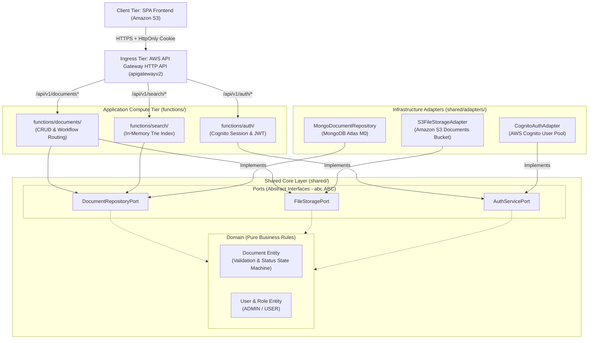

# e-Mailbox Backend V2

<p align="center">
  
  
  
  
  
  
</p>

---

## 📖 Overview

The **Version 2 Backend** for the e-Mailbox Document Routing & Tracking System is an enterprise-grade refactor transitioning from a monolithic Flask "Fat Lambda" into **feature-scoped Serverless Micro-Lambdas**.

Built strictly around **Hexagonal Architecture (Ports and Adapters)**, this architecture decouples core document workflow business logic from external cloud providers, enabling sub-20ms cold starts, granular least-privilege security, and 100% offline unit-testability without active database connections.

---

## 📑 Table of Contents
- [Architecture at a Glance](#-architecture-at-a-glance)
- [Directory Structure](#-directory-structure)
- [Hexagonal Dependency Flow](#-hexagonal-dependency-flow)
- [Lambda Function Routing Matrix](#-lambda-function-routing-matrix)
- [Configuration & Environment Variables](#-configuration--environment-variables)
- [Offline Unit Testing Philosophy](#-offline-unit-testing-philosophy)
- [Security & Compliance Highlights](#-security--compliance-highlights)

---

## 🏛️ Architecture at a Glance



---

## 📁 Directory Structure

```text
backend_v2/
├── README.md                       # High-level architecture, contracts, and system topology
│
├── shared/                         # Reusable Shared Layer (Packaged as AWS Lambda Layer)
│   ├── README.md                   # Shared layer design & port usage guide
│   ├── domain/                     # Pure business entities & validation (Zero framework deps)
│   │   ├── __init__.py
│   │   ├── document.py             # Document entity & workflow state transitions
│   │   └── user.py                 # User identity & role specifications (ADMIN, USER)
│   │
│   ├── ports/                      # Outbound abstract interfaces (Python abc.ABC)
│   │   ├── __init__.py
│   │   ├── document_repository.py  # Abstract persistence interface
│   │   ├── file_storage.py         # Abstract object storage interface
│   │   └── auth_service.py         # Abstract identity provider interface
│   │
│   └── adapters/                   # Concrete outbound adapters plugging into ports
│       ├── __init__.py
│       ├── mongo_document_repository.py  # MongoDB Atlas implementation
│       ├── s3_file_storage.py            # Amazon S3 implementation
│       └── local_file_storage.py         # Local filesystem / mock implementation
│
└── functions/                      # Isolated AWS Lambda Functions (1 folder per Lambda)
    ├── documents/                  # Lambda 1: Document metadata CRUD & workflow status
    │   ├── README.md               # Function spec, event payload schema, and test guide
    │   ├── handler.py              # AWS Lambda entrypoint: def lambda_handler(event, context)
    │   └── use_cases.py            # Business orchestrator
    │
    ├── search/                     # Lambda 2: In-memory Trie prefix search
    │   ├── README.md               # Prefix search documentation
    │   ├── handler.py              # Handler entrypoint
    │   └── use_cases.py            # Trie index builder & query service
    │
    └── auth/                       # Lambda 3: AWS Cognito authentication & session handling
        ├── README.md               # Auth flow, cookie lifecycle, and error matrix
        ├── handler.py              # Handler entrypoint
        └── use_cases.py            # Login, logout, and token verification
```

---

## 🔄 Hexagonal Dependency Flow

In accordance with Clean Architecture principles:
1. **Dependencies Always Point Inward**: Outer layers (Adapters, API Gateway Handlers) depend on inner layers (Ports, Domain). The Domain Core has **zero external dependencies**.
2. **Ports Define Contracts**: The domain dictates what it needs to function via interfaces (`ports/`). It does not care whether data is stored in MongoDB, PostgreSQL, or memory.
3. **Pluggable Adapters**: Concrete adapters in `adapters/` implement port interfaces. Swapping S3 for MinIO or MongoDB for DynamoDB requires writing a new adapter without touching a single line of business logic.

---

## 🗺️ Lambda Function Routing Matrix

All endpoints are exposed through **AWS API Gateway HTTP API (v2)**:

| Method | Endpoint Path | Target Function Folder | Auth Required | Description |
| :---: | :--- | :--- | :---: | :--- |
| `POST` | `/api/v1/auth/login` | `functions/auth/` | Public | Authenticates via Cognito, issues `HttpOnly` cookie |
| `POST` | `/api/v1/auth/logout` | `functions/auth/` | Authenticated | Clears session cookie |
| `GET` | `/api/v1/auth/me` | `functions/auth/` | Authenticated | Returns current authenticated user and roles |
| `GET` | `/api/v1/documents` | `functions/documents/` | Role-Filtered | ADMIN sees all; USER sees only assigned docs |
| `POST` | `/api/v1/documents` | `functions/documents/` | `ADMIN` only | Uploads file and registers document metadata |
| `GET` | `/api/v1/documents/{id}` | `functions/documents/` | Role-Filtered | Retrieves single document details |
| `POST` | `/api/v1/documents/{id}/assign` | `functions/documents/` | `ADMIN` only | Assigns/re-routes document to recipient users |
| `PATCH` | `/api/v1/documents/{id}/status` | `functions/documents/` | Assigned User | Updates workflow state (`ACKNOWLEDGED`, etc.) |
| `GET` | `/api/v1/documents/{id}/file` | `functions/documents/` | Role-Filtered | Streams binary document file |
| `GET` | `/api/v1/search/trie` | `functions/search/` | Authenticated | Retrieves prefix tree for instantaneous search |

---

## ⚙️ Configuration & Environment Variables

Environment variables are passed into individual Lambdas via AWS Lambda configuration:

| Variable Name | Required | Default | Description |
| :--- | :---: | :--- | :--- |
| `MONGO_URI` | **Yes** | `None` | MongoDB Atlas SRV connection string with credentials |
| `S3_BUCKET_NAME` | **Yes** | `cs361-g3-documents` | Private Amazon S3 bucket name for PDF/image storage |
| `AWS_REGION` | **Yes** | `us-east-1` | AWS deployment region |
| `COGNITO_USER_POOL_ID` | **Yes** | `None` | AWS Cognito User Pool Identifier |
| `COGNITO_CLIENT_ID` | **Yes** | `None` | AWS Cognito App Client ID (`ALLOW_USER_PASSWORD_AUTH`) |
| `FRONTEND_ORIGIN` | **Yes** | `None` | Exact S3 website hosting origin (e.g., `http://...`) for strict CORS cookies |

---

## 🧪 Offline Unit Testing Philosophy

Thanks to Hexagonal abstract ports, you can test entire use cases in **under 10 milliseconds** without running MongoDB, Docker, or AWS:

```python
# test_document_use_case.py
from backend_v2.shared.ports.document_repository import DocumentRepositoryPort
from backend_v2.shared.domain.document import Document

class InMemoryDocumentRepo(DocumentRepositoryPort):
    def __init__(self):
        self.docs = {}

    def create(self, doc: Document) -> Document:
        doc.id = "mock-id-123"
        self.docs[doc.id] = doc
        return doc

    def get_by_id(self, doc_id: str):
        return self.docs.get(doc_id)

def test_document_creation_flow():
    repo = InMemoryDocumentRepo()
    # Execute use case with pure in-memory mock adapter
    # Instant execution, zero cloud dependency!
```

---

## 🛡️ Security & Compliance Highlights

> [!IMPORTANT]
> **Token Security Architecture (No `localStorage`)**  
> In accordance with secure cloud application design, JWT authentication tokens are **never stored in `localStorage` or `sessionStorage`** on the client, eliminating the risk of Cross-Site Scripting (XSS) token theft.  
> Authentication sessions are governed strictly via **`HttpOnly; Secure; SameSite=None` Cookies** issued by the auth handler and verified at the API Gateway / Lambda boundary.
