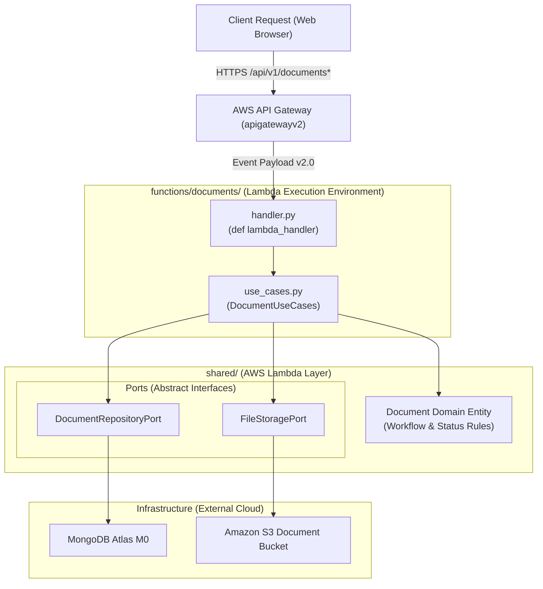

# Documents Micro-Lambda Function

<p align="center">
  
  
  
</p>

---

## 📖 Overview

The **Documents Micro-Lambda** (`functions/documents/`) is the central application worker responsible for document lifecycle management, including:
- Document metadata registration and binary file upload to Amazon S3.
- Role-based document listing (Admins view all; Users view only assigned documents).
- Recipient routing and assignment (`POST /api/v1/documents/{id}/assign`).
- Workflow status state transitions (`PATCH /api/v1/documents/{id}/status`).
- Binary file streaming and download delivery (`GET /api/v1/documents/{id}/file`).

---

## 🏛️ Architecture & Port Composition

This function adheres strictly to Clean Architecture. The entrypoint handler parses raw AWS API Gateway HTTP API (Payload v2.0) events and delegates execution to `DocumentUseCases`, which interacts exclusively with abstract ports:



---

## 🗺️ Route Mapping Matrix

This single micro-Lambda handles all document-related routes routed by API Gateway:

| Method | Route Path | Access Control | Description |
| :---: | :--- | :---: | :--- |
| `GET` | `/api/v1/documents` | Role-Filtered | Lists documents (`ADMIN` sees all; `USER` sees assigned only) |
| `POST` | `/api/v1/documents` | `ADMIN` only | Uploads binary file and registers document metadata |
| `GET` | `/api/v1/documents/{id}` | Role-Filtered | Fetches single document details by ID |
| `POST` | `/api/v1/documents/{id}/assign` | `ADMIN` only | Assigns/re-routes document to recipient user IDs |
| `PATCH` | `/api/v1/documents/{id}/status` | Assigned User | Transitions workflow state (`ACKNOWLEDGED`, `IN_PROGRESS`, etc.) |
| `GET` | `/api/v1/documents/{id}/file` | Role-Filtered | Streams binary PDF/image file from S3 |

---

## 📋 Request & Response Contracts

### 1. Assign Recipients
* **Endpoint**: `POST /api/v1/documents/{id}/assign`
* **Request Body** (JSON):
  ```json
  {
    "recipients": ["prof_somchai", "prof_kanna"],
    "note": "Urgent review for curriculum meeting"
  }
  ```
* **Success Response** (`200 OK`):
  ```json
  {
    "message": "Document assigned successfully",
    "status": "ASSIGNED",
    "assigned_to": ["prof_somchai", "prof_kanna"]
  }
  ```

### 2. Update Workflow Status (e.g. Lecturer Acknowledges Receipt)
* **Endpoint**: `PATCH /api/v1/documents/{id}/status`
* **Request Body** (JSON):
  ```json
  {
    "status": "ACKNOWLEDGED",
    "note": "Confirmed receipt and reviewed memo"
  }
  ```
* **Success Response** (`200 OK`):
  ```json
  {
    "message": "Status updated successfully",
    "status": "ACKNOWLEDGED"
  }
  ```

---

## ⚙️ Environment Variables

| Variable Name | Required | Description |
| :--- | :---: | :--- |
| `MONGO_URI` | **Yes** | MongoDB Atlas connection string |
| `S3_BUCKET_NAME` | **Yes** | Private S3 bucket name for PDF/image storage |
| `AWS_REGION` | **Yes** | AWS deployment region (e.g., `us-east-1`) |
| `FRONTEND_ORIGIN`| **Yes** | S3 static hosting URL for CORS cookie validation |

---

## 🧪 Local Execution & Debugging

You can test this Lambda handler locally without deploying to AWS:

```python
from backend_v2.functions.documents.handler import lambda_handler

# Simulate an API Gateway HTTP API v2 GET event
event = {
    "version": "2.0",
    "routeKey": "GET /api/v1/documents",
    "rawPath": "/api/v1/documents",
    "requestContext": {
        "http": {"method": "GET", "path": "/api/v1/documents"}
    },
    "headers": {"cookie": "auth_token=..."}
}

response = lambda_handler(event, context=None)
print(response["statusCode"])  # 200
```
