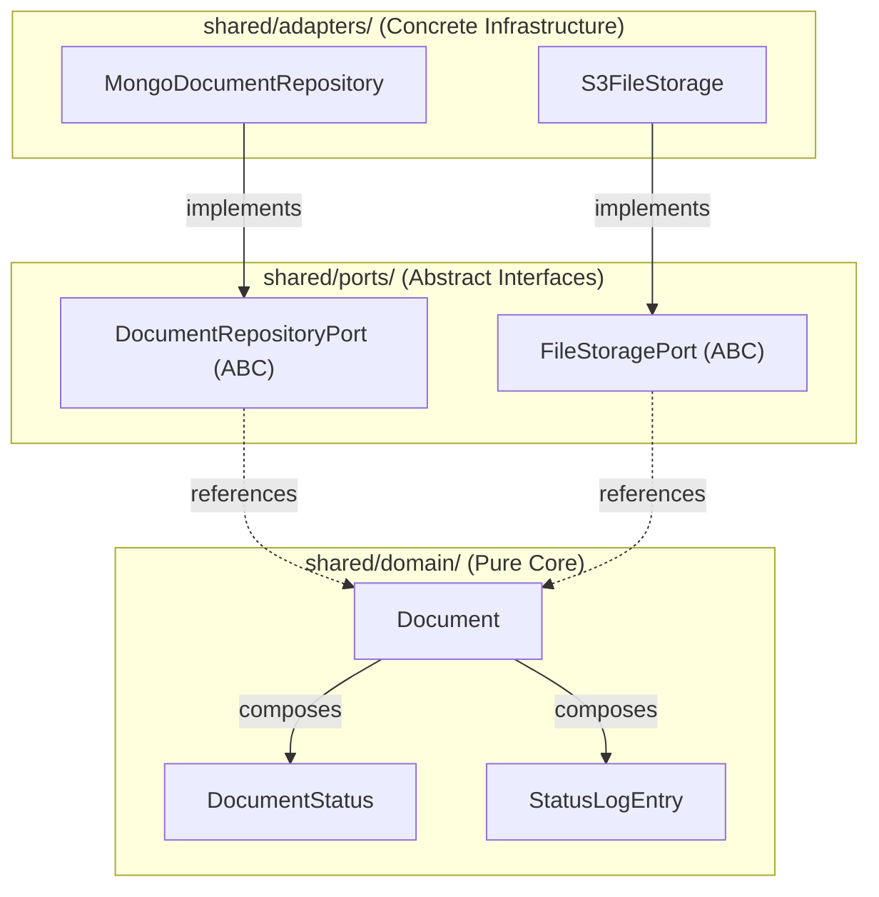

# Shared Core & AWS Lambda Layer

<p align="center">
  
  
  
</p>

---

## 📖 Overview

The `shared/` directory encapsulates the foundational business domain, abstract interfaces (ports), and external cloud adapters that are reused across all feature-scoped micro-Lambdas (`functions/`).

In AWS production deployments, the contents of this directory are bundled into a single **AWS Lambda Layer** (`cs361-g3-shared-layer`), allowing all micro-Lambdas to share common dependencies without code duplication or bloated deployment zips.

---

## 🏛️ Internal Hexagonal Structure

```text
backend_v2/shared/
├── README.md                       # (You are here) Shared core & layer guide
│
├── domain/                         # Pure Business Logic (ZERO external dependencies)
│   ├── __init__.py                 # Barrel exports: Document, DocumentStatus, StatusLogEntry
│   ├── document_status.py          # DocumentStatus enum & ALLOWED_STATUS_TRANSITIONS
│   ├── status_log_entry.py         # StatusLogEntry audit trail value object
│   └── document.py                 # Document aggregate entity (Composes status & audit log)
│
├── ports/                          # Outbound Abstract Interfaces (Python abc.ABC)
│   ├── __init__.py                 # Barrel exports: DocumentRepositoryPort, FileStoragePort
│   ├── document_repository.py      # Abstract persistence contract (CRUD + access filter)
│   └── file_storage.py             # Abstract binary file storage contract (save, get, delete)
│
└── adapters/                       # Concrete Implementations (Plugging into ports)
    ├── __init__.py                 # Barrel exports: MongoDocumentRepository, S3FileStorage
    ├── mongo_document_repository.py# Production MongoDB Atlas adapter
    ├── s3_file_storage.py          # Production AWS S3 document bucket adapter
    └── local_file_storage.py       # Local filesystem / mock adapter for offline testing
```

---

## 🔄 Dependency Inversion Rule



1. **Domain is King**: `shared/domain/` has **zero external imports**. It does not know that MongoDB, S3, or AWS exist.
2. **Ports Define the Need**: `shared/ports/` defines what data operations are required by use-cases.
3. **Adapters Implement the Need**: `shared/adapters/` contains concrete network/database drivers implementing the port interfaces.

---

## 🧪 Testing with Mock Ports (No Database Needed)

Because use-cases depend on `ports/` rather than concrete `adapters/`, you can test entire features offline in milliseconds using in-memory mock implementations:

```python
from backend_v2.shared.ports import DocumentRepositoryPort
from backend_v2.shared.domain import Document

class InMemoryDocumentRepo(DocumentRepositoryPort):
    """In-memory mock database for 10ms offline tests."""
    def __init__(self):
        self._store = {}

    def get_by_id(self, doc_id: str):
        return self._store.get(doc_id)

    def find_all(self, filter_criteria=None):
        return list(self._store.values())

    def find_by_assigned_user(self, user_id: str):
        return [d for d in self._store.values() if d.is_accessible_by(user_id)]

    def create(self, doc: Document):
        doc.id = f"mock-{len(self._store) + 1}"
        self._store[doc.id] = doc
        return doc

    def update(self, doc_id: str, changes: dict):
        return str(doc_id) in self._store

    def delete(self, doc_id: str):
        return self._store.pop(str(doc_id), None) is not None
```

---

## 📦 Packaging for AWS Lambda Layer

AWS Lambda expects Layer zip packages to place Python modules under a `python/` directory:

```text
cs361-g3-shared-layer.zip
└── python/
    └── backend_v2/
        └── shared/
            ├── domain/
            ├── ports/
            └── adapters/
```

When attached to a Lambda function, AWS automatically places `/opt/python` onto Python's `sys.path`, allowing any handler to import cleanly:
```python
from backend_v2.shared.domain import Document, DocumentStatus
from backend_v2.shared.ports import DocumentRepositoryPort
```
