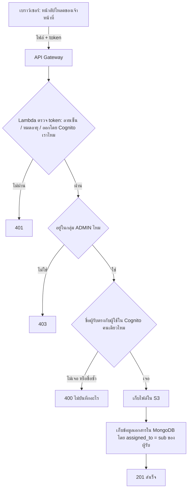

# สรุปงาน: แก้ช่องโหว่การยืนยันตัวตนของ backend_v2

> ณ วันที่ 2026-10-31
> - โค้ดที่แก้แล้วอยู่ใน commit `4bda181` (ต่อจาก `b52f483` ซึ่งเป็น `origin/main` ตอนเริ่มงาน)
> - ยังไม่ได้ deploy และยังไม่ได้ย้ายข้อมูลเก่า
> - ถ้าจะให้ AI ทำต่อ ให้ AI อ่าน [`../ai-instructions/README.md`](../ai-instructions/README.md)

## 1. คำขอ

เจ้าของงานแจ้งว่าระบบควบคุมสิทธิ์ของ backend_v2 ถูกข้ามได้ เพราะ Lambda ทั้งสามตัว (auth, documents, search) อ่าน token โดยไม่ตรวจลายเซ็น และไม่มี authorizer ที่ API Gateway ใครก็ปลอมตัวเป็นแอดมินหรือผู้ใช้คนอื่นได้ และขอให้:

- วางแผนก่อนลงมือ โดยเขียนงานให้ละเอียดพอที่ AI รุ่นเล็กกว่าทำตามได้
- ย้ายไฟล์ที่ไม่เกี่ยวกับโปรเจกต์ออกจาก repo แล้วเริ่มลงมือ
- เลขที่เอกสารอัตโนมัติ และการส่งต่อเอกสารให้หลายคน แยกไปทำเป็นงานถัดไป

## 2. ผลการวิเคราะห์: ปัญหาเดิม

เปรียบเทียบง่ายๆ: ระบบเดิมเหมือนยามที่อ่านชื่อบนบัตร แต่ไม่เคยตรวจว่าบัตรเป็นของจริง ใครพิมพ์บัตรปลอมเขียนว่า "แอดมิน" ก็เข้าได้ทุกห้อง

1. อ่านข้อมูลใน token (JWT) โดยไม่ตรวจลายเซ็น วันหมดอายุ หรือว่าออกโดย Cognito ของเราจริงไหม
2. เดาว่าใครเป็นแอดมินจากข้อความ ถ้าอีเมลหรือชื่อที่แสดงมีคำว่า "admin" หรือ "staff" ก็ได้สิทธิ์แอดมิน ทั้งที่ผู้ใช้ตั้งชื่อเองได้
3. ถ้า Cognito มีปัญหา ระบบยอมให้ล็อกอินผ่าน MongoDB โดยเทียบรหัสผ่านตรงๆ มีบัญชีแอดมินฝังในโค้ด (`admin@kanna.ac.th` / `admin1234`) และสร้าง token ที่ไม่มีลายเซ็น (`alg: none`) ให้เอง
4. `GET /api/v1/auth/users` ดูรายชื่อผู้ใช้ได้โดยไม่ต้องล็อกอิน
5. จับคู่เอกสารกับผู้รับด้วยชื่อหรืออีเมล ถ้าเปลี่ยนชื่อตัวเองให้ตรงกับอาจารย์คนอื่น ก็เปิดไฟล์ของเขาได้
6. เวลาเกิด error ระบบส่งรายละเอียดภายใน (เช่นชื่อเครื่องฐานข้อมูล) กลับไปให้ผู้ใช้ และพิมพ์ข้อมูลตัวตนลง log

## 3. แผนที่ใช้

1. เขียนข้อกำหนดของบั๊ก: พฤติกรรมตอนนี้ / ที่ควรเป็น / ที่ห้ามเปลี่ยน (`../ai-instructions/spec/bugfix.md`)
2. ออกแบบวิธีแก้ (`design.md`) แล้วแตกเป็นงานย่อย (`tasks.md`)
3. เขียน test ที่ต้อง "ล้ม" บนโค้ดเก่าก่อน เพื่อพิสูจน์ว่าบั๊กมีจริง
4. เขียน test ที่ต้อง "ผ่าน" บนโค้ดเก่า เพื่อกันการใช้งานปกติพัง
5. แก้โค้ดทีละชั้น แล้วรัน test ทั้งสองชุดซ้ำ
6. deploy และย้ายข้อมูลจริง เฉพาะเมื่อเจ้าของงานอนุญาต

## 4. แก้อะไรไปแล้ว

| เรื่อง | ก่อนแก้ | หลังแก้ |
|---|---|---|
| ตรวจ token | ไม่ตรวจเลย | ตรวจลายเซ็นกับกุญแจของ Cognito (RS256) ผู้ออก client วันหมดอายุ และต้องเป็น ID token |
| สิทธิ์แอดมิน | เดาจากชื่อ อีเมล หรือ claim อื่น | ต้องอยู่ในกลุ่ม `ADMIN` ของ Cognito เท่านั้น ใช้กฎเดียวกันทุก Lambda |
| ล็อกอิน | มีทางลัดหลายทางเมื่อ Cognito ล่ม | ใช้ Cognito อย่างเดียว ถ้า Cognito ล่มตอบ 503 |
| รายชื่อผู้ใช้ | ใครก็ดูได้ | ต้องล็อกอิน และได้แค่ id กับชื่อ |
| สิทธิ์เปิดเอกสาร | เทียบจากชื่อหรืออีเมล | เทียบจาก `sub` (รหัสผู้ใช้ใน Cognito ที่เปลี่ยนไม่ได้) เท่านั้น |
| error และ log | ส่งรายละเอียดภายในให้ผู้ใช้ | ผู้ใช้เห็นแค่ "Internal server error" และไม่มีข้อมูลตัวตนใน log |

ของที่เพิ่มมา:
- test 379 ข้อใน `tests/v2/` รันได้โดยไม่ต้องต่อ AWS หรือ MongoDB
- สคริปต์ย้ายข้อมูลเก่า `scripts/migrate_assigned_to_sub.py` เปลี่ยนชื่อผู้รับในเอกสารเก่าเป็น `sub`
- แก้ `aws_deploy/deploy_v2.py` ให้ติดตั้งไลบรารีถูกแพลตฟอร์มสำหรับ Lambda และเพิ่ม PyJWT

หน้าเว็บ (frontend) ไม่ได้แก้ ยังส่งชื่อผู้รับมาเหมือนเดิม เซิร์ฟเวอร์จะแปลงชื่อเป็น `sub` เอง

## 5. ภาพการทำงาน: แอดมินอัปโหลดเอกสาร



ตอนผู้รับเปิดไฟล์: ตรวจ token แบบเดียวกัน แล้วเช็กว่า `sub` ของเขาอยู่ใน `assigned_to` ไหม (แอดมินไม่ต้องเช็ก) ถ้าผ่านจึงดึงไฟล์จาก S3 ส่งกลับ

## 6. สถานะ

| งาน | สถานะ |
|---|---|
| วางแผน (bugfix / design / tasks) | เสร็จ |
| test พิสูจน์บั๊ก 12 ข้อ | เสร็จ ล้มครบบนโค้ดเก่า และผ่านครบบนโค้ดใหม่ |
| test กันของเดิมพัง 34 ข้อ | เสร็จ ผ่านทั้งก่อนและหลังแก้ |
| แก้โค้ด (task 3.1 ถึง 3.18) | เสร็จ |
| รัน test ยืนยันรอบสุดท้าย (task 3.19 และ 4) | ทำไม่ครบ คำสั่งถูกยกเลิกกลางทาง แต่การรันชุดเต็มครั้งล่าสุดผ่าน 379 ข้อ |
| deploy, smoke check, ย้ายข้อมูล (task 5) | ยังไม่เริ่ม รอ AWS lab และ MongoDB |

ระบบที่ deploy อยู่บน AWS ตอนนี้ (ถ้ามี) ยังเป็นโค้ดเก่าที่มีช่องโหว่ จนกว่าจะ deploy ใหม่

## 7. งานที่เหลือ ทำตามลำดับ

รันทุกคำสั่งในโฟลเดอร์ `CS361_G3` และต้องติดตั้ง [uv](https://docs.astral.sh/uv/) ก่อน

**ขั้นที่ 1: รัน test** (ไม่ต้องใช้ AWS)
```
uv run --with-requirements requirements-dev.txt pytest -q
```
ควรได้ `379 passed` ถ้ามีข้อไหนล้ม อย่าแก้ test ให้ผ่าน ให้หาว่าโค้ดผิดตรงไหน

**ขั้นที่ 2: deploy** ต้องเปิด AWS Academy lab ก่อน และ `.env` ต้องมี `COGNITO_USER_POOL_ID` กับ `COGNITO_CLIENT_ID`
```
uv run aws_deploy/deploy_v2.py
```
จด URL ของ API ที่สคริปต์พิมพ์ออกมา

**ขั้นที่ 3: smoke check** เรียก API จริงตามรายการใน `../ai-instructions/spec/design.md` หัวข้อ "Post-deployment smoke check" จุดสำคัญคือ `GET /api/v1/auth/users` ด้วย token ของ staff1 ถ้าได้ 500 แปลว่า LabRole อาจไม่มีสิทธิ์เรียก `cognito-idp:ListUsers` ให้ดู CloudWatch log ของ `cs361-g3-v2-auth` และอย่าเพิ่มทางลัดในโค้ด

**ขั้นที่ 4: ย้ายข้อมูลเก่า** (MongoDB ต้องใช้งานได้)
```
uv run scripts/migrate_assigned_to_sub.py
uv run scripts/migrate_assigned_to_sub.py --apply --backup-file ~/assigned_to_backup.json
```
- คำสั่งแรกเป็น dry run แสดงว่าจะเปลี่ยนเอกสารไหน ไม่เขียนอะไร บรรทัด `UNRESOLVED` คือเอกสารที่หาผู้รับไม่เจอ ต้องตัดสินใจเอง
- `--apply` เขียนไฟล์ backup ก่อนแก้ข้อมูลเสมอ เก็บไฟล์นี้ไว้ ถ้าต้องย้อนกลับใช้ `--restore <ไฟล์ backup>`

## 8. ข้อควรระวัง

- สคริปต์ย้ายข้อมูลอ่าน `.env` เสมอ แม้แต่ dry run ก็เชื่อมต่อฐานข้อมูลจริง (แค่ไม่เขียน)
- ต้องใช้ Cognito user pool เดิมตลอด ถ้ารัน `setup_cognito.py` แล้วได้ pool ใหม่ `sub` ของทุกคนจะเปลี่ยน และเอกสารที่ย้ายข้อมูลแล้วจะเปิดไม่ได้ ถามเจ้าของงานก่อนรันสคริปต์นี้
- ระหว่าง deploy เสร็จกับย้ายข้อมูลเสร็จ ผู้รับจะเปิดเอกสารเก่าไม่ได้ (แอดมินยังเห็นทั้งหมด) ควรทำสองขั้นนี้ติดกัน มีทางเลือกที่ไม่มีช่วงนี้ใน `../ai-instructions/README.md` หัวข้อ 7.4
- ผู้ใช้ต้องล็อกอินใหม่เมื่อ token หมดอายุ (ค่าเริ่มต้นของ Cognito คือ 1 ชั่วโมง) เพราะตอนนี้ตรวจวันหมดอายุจริงแล้ว แต่ cookie ยังตั้งไว้ 24 ชั่วโมง และยังไม่มีระบบต่ออายุ token
- หลังส่งต่อ (forward) เอกสาร ผู้รับคนเดิมจะเปิดเอกสารนั้นไม่ได้อีก ตั้งใจให้เป็นแบบนี้จนกว่าจะทำฟีเจอร์ส่งหลายคน
- ถ้าพิมพ์ชื่อผู้รับที่ไม่มีในระบบ หรือชื่อซ้ำกันหลายคน ระบบตอบ 400
- ถ้า LabRole ไม่มีสิทธิ์ `ListUsers` การอัปโหลด การส่งต่อ และ `/auth/users` จะได้ 500
- ถ้ามีหน้าเว็บไหนเรียก `/api/v1/auth/users` โดยไม่ส่ง token ตอนนี้จะได้ 401
- เอกสารที่รับทราบแล้ว (ACKNOWLEDGED) ส่งต่อไม่ได้ เป็นกฎเดิมของระบบ ไม่ได้เกิดจากงานนี้

## 9. สิ่งที่ควรทำต่อ

รายละเอียดเต็มอยู่ใน [`../ai-instructions/backlog.md`](../ai-instructions/backlog.md)

ความปลอดภัย (สำคัญมากไปน้อย):
1. **CSRF:** cookie ล็อกอินตั้ง `SameSite=None` เว็บอื่นจึงทำให้เบราว์เซอร์ส่ง cookie มาได้ ฟอร์มธรรมดาบนเว็บอื่นอาจสั่งส่งต่อเอกสารแทนผู้ใช้ที่ล็อกอินอยู่ (ยังไม่ได้ทดสอบจริง)
2. หน้าเว็บควรส่ง `sub` ของผู้รับ (ได้จาก `/auth/users`) แทนชื่อ และห้ามผู้ใช้แก้ชื่อตัวเองใน Cognito
3. ไฟล์ใหญ่: Lambda รับส่งข้อมูลได้ไม่เกิน 6 MB และไฟล์ถูกแปลงเป็น base64 ซึ่งใหญ่ขึ้นราว 33% ไฟล์ที่เกินประมาณ 4.5 MB จึงอัปโหลดหรือดาวน์โหลดไม่ได้ ควรใช้ S3 presigned URL หลังตรวจสิทธิ์
4. ตั้งค่า S3 ให้ชัด: ปิดการเข้าถึงสาธารณะ บังคับ HTTPS เข้ารหัส และเปิด versioning (ตอนนี้โค้ดแค่สร้าง bucket)
5. ตรวจไฟล์ที่อัปโหลด: จำกัดชนิดไฟล์และขนาด และส่งไฟล์กลับพร้อม header ที่กันเบราว์เซอร์รันโค้ด
6. CORS: Lambda ตอบ Origin อะไรก็ได้กลับไป ควรใช้ allow-list เดียวกับ API Gateway
7. ย้าย `MONGO_URI` ออกจาก environment variable ของ Lambda ไปไว้ใน SSM หรือ Secrets Manager (ถ้า lab อนุญาต)
8. จำกัดจำนวนการเรียก API โดยเฉพาะ `/auth/login` และเปิด access log
9. VPC: ยังไม่แนะนำใน AWS Academy เพราะต้องใช้ NAT gateway ซึ่งมีค่าใช้จ่าย เพื่อให้ Lambda ยังต่อ Cognito และ MongoDB Atlas ได้ ประโยชน์หลักคือจำกัด IP ที่เข้า Atlas ได้

ฟีเจอร์:
1. เลขที่เอกสารที่ระบบออกให้อัตโนมัติ (ตอนนี้มีแค่ ObjectId ของ MongoDB)
2. ส่งเอกสารให้หลายคน และส่งต่อโดยไม่ลบผู้รับเดิม พร้อมเก็บประวัติการส่ง
3. ตัดสินใจว่าเอกสารที่รับทราบแล้วควรส่งต่อได้หรือไม่
4. ชื่อไฟล์ภาษาไทยหายตอนเก็บใน S3 เช่น `หนังสือเชิญ.pdf` จะกลายเป็น `pdf` (อ่านจากโค้ด ยังไม่ได้ทดสอบ) ควรเก็บชื่อจริงไว้แสดงผล
5. ระบบต่ออายุ token เพื่อไม่ต้องล็อกอินใหม่ทุกชั่วโมง
6. ตั้ง CI (เช่น GitHub Actions) ให้รัน test ทุกครั้งที่ push

## 10. ข้อสรุป

ต้นเหตุคือระบบเชื่อข้อมูลใน token โดยไม่ตรวจ และใช้ข้อความที่ผู้ใช้แก้เองได้มาตัดสินสิทธิ์ ตอนนี้ทุก Lambda ตรวจ token กับ Cognito ก่อนทำงาน ตัดสินแอดมินจากกลุ่ม `ADMIN` อย่างเดียว และให้สิทธิ์เปิดเอกสารจาก `sub` เท่านั้น test ยืนยันว่าบั๊กเดิมทั้ง 12 กรณีหายไป และการใช้งานปกติยังเหมือนเดิม สิ่งที่ยังเสี่ยงคือขั้นนำขึ้นระบบจริง ได้แก่ deploy, สิทธิ์ `ListUsers` และการย้ายข้อมูลเก่า

## 11. ศัพท์

- **token / JWT:** บัตรผ่านดิจิทัลที่ Cognito ออกให้หลังล็อกอิน มีลายเซ็นกันปลอม
- **sub:** รหัสผู้ใช้ใน Cognito เป็น UUID ที่ไม่เปลี่ยน ใช้ตัดสินสิทธิ์
- **กลุ่ม ADMIN:** กลุ่มผู้ใช้ใน Cognito คนในกลุ่มนี้เท่านั้นที่เป็นแอดมิน
- **assigned_to:** ช่องในเอกสารที่เก็บ `sub` ของคนที่เปิดเอกสารได้
- **migration:** การแปลงข้อมูลเก่าในฐานข้อมูลให้ตรงกับรูปแบบใหม่
- **dry run:** รันเพื่อดูผลก่อน โดยไม่เขียนอะไรจริง
